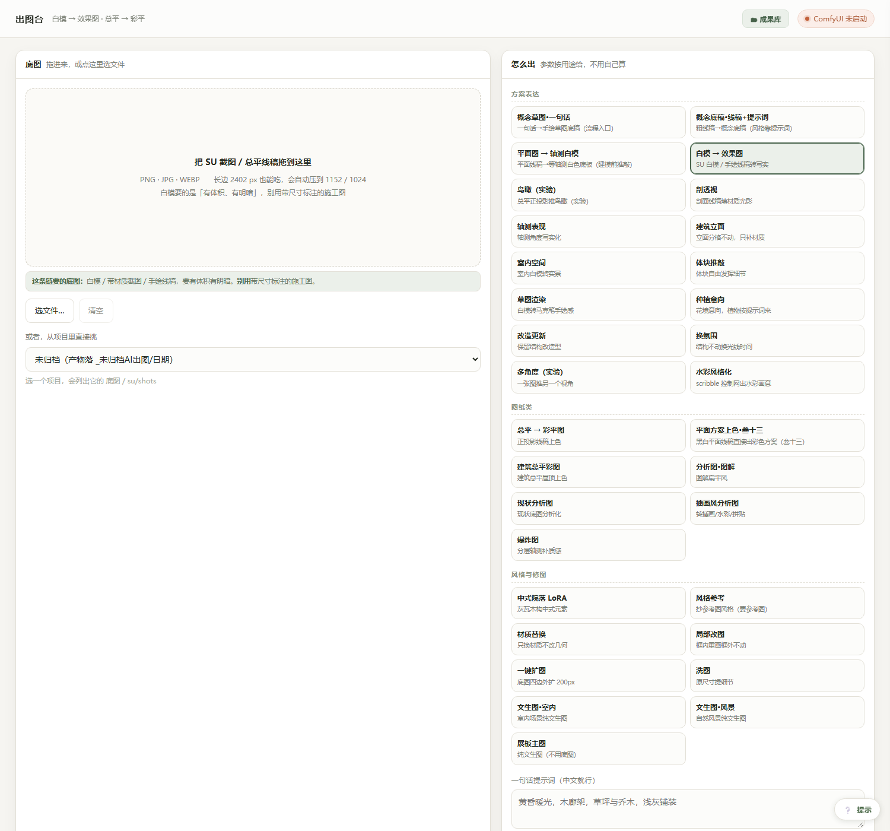

# ChuTai 景观出图台

给风景园林/建筑方案出图用的本地工作台：一个 Python 标准库服务 + 三个纯前端页面，
把 ComfyUI 变成「按链出图」的傻瓜引擎——拖一张底图、选一条链、点生成。



## 三个工作台

| 页面 | 干什么 |
|---|---|
| `/`（出图台） | 32 条出图链：白模→效果图、CAD 线稿→彩平、航拍鸟瞰、剖透视、爆炸图、风格化、扩图、放大…… |
| `/editor.html`（编辑台） | 画笔/矩形/多边形/套索圈选区域做**局部重绘**；文字/箭头/方框**批注**（16 种本机字体） |
| `/board.html`（展板台） | 多图画布排版：A0–A3 模板、13 套版式（三段叙事 / 2/3 大图 / C 字环绕 / 网格杂志 / T 字形 / 总平中心 / 压底大图等），图层/旋转/对齐，导出 PNG 或 **Photoshop 脚本 (.jsx)** |
| `/assets.html`（素材库） | 可靠素材平台导航（24 个站，标注授权类型）+ 本地素材收纳（分类文件夹、缩略图、一键送展板台/编辑台） |

另有成果库：按「三大类 → 出图类别 → 出处」自动归档 97+ 张出图记录，可直接删除/撤销归档。

## 环境要求

- **Windows**（bat 启动器；其他系统用 `python panel.py` 也能跑）
- **Python 3.10+**，只需 `pip install pillow`（服务端没有其他第三方依赖）
- **ComfyUI**，自己启动、常驻 8188 端口——本工具只提交任务，**绝不代替你启停它**
- ComfyUI 里装好（见下表）模型与两个自定义节点包

### 需要放进 ComfyUI 的模型

| 文件 | 放哪 |
|---|---|
| `Juggernaut-XL_v9_RunDiffusionPhoto_v2.safetensors` | `models/checkpoints/` |
| `controlnet-union-sdxl-1.0.safetensors` | `models/controlnet/` |
| `sansan_plan_XL_v1.safetensors`（叁十三平面图 LoRA） | `models/loras/` |
| `sdxl_architecture_siheyuan.safetensors` | `models/loras/` |
| `4x-UltraSharp.pth` | `models/upscale_models/` |
| `depth_anything_vitb14.pth` | 装了 controlnet_aux 后按提示放，或让它自动下载 |

### 自定义节点（用 ComfyUI Manager 装最省事）

- `comfyui_controlnet_aux`（Canny / LineArt / Scribble / DepthAnything 预处理器）
- `ComfyUI_IPAdapter_plus`（风格参考链用）

## 启动

1. 双击 `双击启动出图台.bat`（自动找 Python；也可以自己 `python panel.py`）
2. 浏览器开 <http://127.0.0.1:8760>
3. 自己启动 ComfyUI（默认 8188），页面右上角状态灯变绿即可出图

批注、展板、成果库**不需要 ComfyUI**，开箱即用；只有「生成」类按钮需要它在线。

## 可配置项（环境变量，都有默认值）

| 变量 | 含义 | 默认 |
|---|---|---|
| `CHUTAI_PROJECTS` | 设计项目根目录（成果库按 `分类/项目/出图/AI方案稿` 归档） | 有 `D:\workplace\设计项目` 用它，否则用仓库内 `项目/` |
| `CHUTAI_PYTHON` | 子任务用的 python.exe | 启动面板的同一个 Python |
| `COMFY_TOOLBOX` | 工作流模板根目录 | 仓库自带 `workflows/`（已内置，不用设） |
| `COMFY` | ComfyUI 地址 | `http://127.0.0.1:8188` |

## 目录结构

```
panel.py            本地服务（纯标准库 + Pillow），所有页面与 API
library.py          成果库：扫描/分类/直删/归档/撤销/缩略图
ui.html             出图台主页面
editor.html         编辑台（区域重绘 + 批注）
board.html          展板台（多图排版 + PS 脚本导出）
chains/*.json       32 条链配置（提示词/模型/参数）
workflows/api/      ComfyUI API 工作流模板 + _node_map.json（参数注入表）
bridge/             comfy_bridge.py 出图引擎（提交任务到 ComfyUI API）
upscale.py          两倍放大脚本
双击启动出图台.bat   启动器
说明.md             详细使用说明（32 条链逐条实测记录）
```

## 安全与边界

- 只监听 `127.0.0.1`，局域网其他机器访问不到
- 删除接口有白名单：只认项目目录里带出图特征的文件，`C:\Windows` 之类一律拒绝
- 不上传任何数据到外部；一切都在本机

## 常见问题

- **右上角一直黄灯**：ComfyUI 没启动。去启动它，本工具不会代劳。
- **出图报退出码 9**：同上，ComfyUI 不在线。
- **显存不够（8GB 卡）**：用「快速」档；页面会显示每张图的峰值显存实测。
- **生成的图去哪了**：项目目录的 `出图/AI方案稿/`，或在成果库里直接看。
